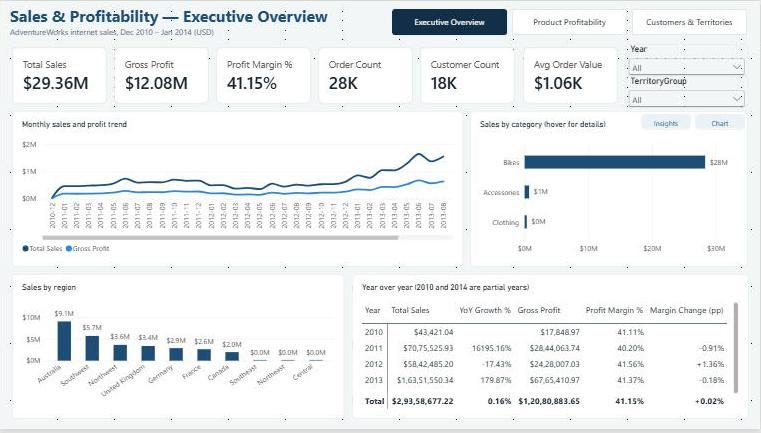
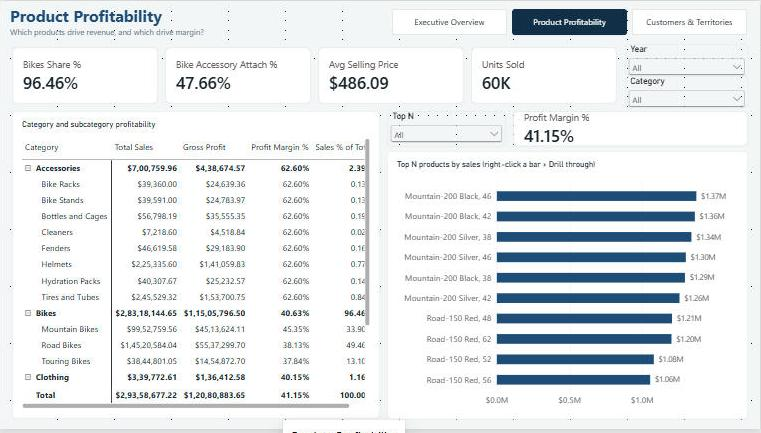
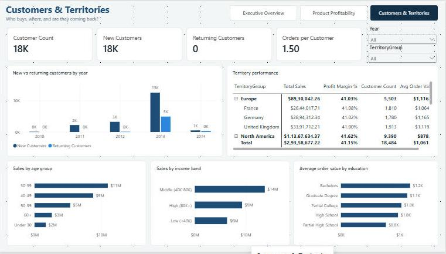

# Sales & Profitability Analytics Dashboard

**Power BI · DAX · Power Query · SQL Server (T-SQL)**

An end-to-end BI project on Microsoft's **AdventureWorksDW2022** sample data warehouse. It covers the whole path: SQL Server views shape a star schema, Power Query cleans it, DAX measures do the analysis, a 4-page interactive Power BI report presents it, and territory-level row-level security controls who sees what. Every number in the report is **reconciled against SQL** with an automated script.



## Business questions

1. How much do we sell, how profitable is it, and how is it trending (YoY, MTD/QTD/YTD)?
2. Which categories and products drive **revenue**, and which drive **margin**?
3. Who are our customers? How many are new and how many return? Which territories perform best?
4. What should the business do next?

## Key findings (all verified in SQL, see [`sql/08_validate_insights.sql`](sql/08_validate_insights.sql))

| Finding | Number |
|---|---|
| Total internet sales (Dec 2010 – Jan 2014) | **$29.36M** across 27,659 orders / 60,398 order lines |
| Gross profit and margin | **$12.08M**, **41.15%** |
| Bikes share of revenue | **96.46%**, at a **40.63%** margin |
| Accessories margin (highest) | **62.60%**, but only **2.39%** of revenue |
| 2013 vs 2012 sales growth | **+179.87%**, driven by 12,523 new customers and the late-Dec-2012 launch of online accessories and clothing |
| 2013 bike orders that already include an accessory | **74.1%**, so **2,515 bike orders (26%) had none** |
| Largest regions | Australia ($9.06M) and US Southwest ($5.72M) |

**Recommendation:** bundle accessories (helmets, bottles, tyres) with bikes. Bikes bring the revenue and accessories bring the margin. A bundle offer aimed at the 26% of bike orders without an accessory raises margin without needing new customers.

> Caution: 2010 has only 3 days of sales and 2014 only January. YoY figures for those years (+16,195% / −99.7%) are artefacts of partial years, so the report compares only full years.

## Architecture

```
AdventureWorksDW2022 (SQL Server 2022)
        │  sql/02-07  T-SQL views in schema rpt  (select, join, rename, filter)
        ▼
rpt.vw_FactSales  +  vw_DimProduct / vw_DimCustomer / vw_DimTerritory / vw_DimDate
        │  Power Query  (codes → labels, NULL → Unknown, age & income bands, types)
        ▼
Power BI star schema: 1 fact, 4 dimensions, many-to-one single-direction, Date marked as date table
        │  31 DAX measures + Top N what-if table + 3 RLS roles
        ▼
4-page report: KPI cards · drill-through · bookmarks · report-page tooltip · custom theme
        │  tools/reconcile.ps1  (DAX on the model vs T-SQL on the views)
        ▼
22/22 measure checks PASS · 3/3 RLS roles PASS
```

**Design decision:** the SQL views handle *structure* (grain, joins, which rows and columns), and Power Query handles *value cleaning* (labels, unknowns, bands, data types). Each layer has one job, which makes both easy to explain and to change.

### Data model

| Table | Grain | Rows | Notes |
|---|---|---|---|
| Sales (fact) | one order line | 60,398 | Profit per line; margin % is a measure, never a column |
| Product | one product version | 606 | Category/subcategory flattened in (snowflake → star); 158 products sold online |
| Customer | one customer | 18,484 | Age (as of the last order), age group, income band |
| Territory | one sales territory | 10 | Placeholder "NA" row removed; RLS on TerritoryGroup |
| Date | one calendar day | 1,826 | Full years 2010–2014, marked as date table |

## Report pages

| Page | What it shows |
|---|---|
| **Executive Overview** | 6 KPI cards, monthly sales and profit trend, sales by category (with a **report-page tooltip**), sales by region, YoY matrix, and an **Insights / Chart bookmark toggle** |
| **Product Profitability** | Category → subcategory profitability matrix, **dynamic Top N products** (what-if slicer 1–20), bike-accessory attach rate. Right-click a product to **drill through** |
| **Customers & Territories** | New vs returning customers by year, territory matrix, sales by age group, income band and education |
| **Product Detail** *(drill-through)* | Dynamic title, KPIs, monthly trend and regional split for one product, with a back button |

Hidden support pages: *Category Tooltip* (the tooltip canvas) and *QA Checks* (time-intelligence test matrices).

| Product Profitability | Customers & Territories |
|---|---|
|  |  |

## DAX measures (31)

Measures are organised in display folders in the `_Measures` table:

- **Base:** Total Sales, Total Cost, Gross Profit (SUMX), Profit Margin %, Order Count, Units Sold, Avg Order Value, Avg Selling Price
- **Time intelligence:** Sales LY (SAMEPERIODLASTYEAR), YoY Growth %, Sales YTD / QTD / MTD, Running Total (FILTER + ALL), Profit LY, Profit YoY %, Sales YoY Change, Margin Change (pp)
- **Contribution:** Sales % of Total (ALLSELECTED), Bikes Sales, Bikes Share % (ALL), Bike Accessory Attach % (CALCULATETABLE + INTERSECT)
- **Ranking:** Product Rank (RANKX + ISINSCOPE), Top N Sales, Top N Value (what-if parameter)
- **Customers:** Customer Count, New Customers (VAR + FILTER), Returning Customers, Orders per Customer
- **Labels:** Drillthrough Title, Report Title Period

The full definitions are in [`_Measures.tmdl`](powerbi/SalesProfitability.SemanticModel/definition/tables/_Measures.tmdl).

## Row-level security

There are three static roles on `Territory[TerritoryGroup]`: **North America**, **Europe** and **Pacific**. Filters flow from Territory to Sales, so each role sees only its own sales, customers and products sold. To test in Power BI Desktop: *Modeling → View as → role*. The reconciliation script also connects *as each role* and checks the totals against SQL.

## Validation (Phase 8)

[`tools/reconcile.ps1`](tools/reconcile.ps1) connects to the open Power BI Desktop model through its local Analysis Services port. It runs each measure as a DAX query, runs the equivalent T-SQL on the `rpt` views, and compares the two. You can see the latest output in [`docs/reconciliation_results.txt`](docs/reconciliation_results.txt). All **22 measure checks and 3 RLS checks pass**.

## How to run it

1. Install SQL Server 2022 (Developer), SSMS and Power BI Desktop.
2. Download `AdventureWorksDW2022.bak` from Microsoft and restore it with [`sql/00_restore.sql`](sql/00_restore.sql) (edit the paths).
3. Run `sql/02_create_schema.sql` to `sql/07_vw_FactSales.sql` in order. Each file ends with checks and their expected results.
4. Open `powerbi/SalesProfitability.pbip` in Power BI Desktop. If your server is not `localhost`, update it under *Transform data → Data source settings*, then press **Refresh**.
5. *(Optional)* With the report open, run `powershell -ExecutionPolicy Bypass -File tools\reconcile.ps1`.

The report is saved in **PBIP format**: the model is TMDL text and the report is PBIR JSON, so every measure, relationship and visual is version-controlled and reviewable in Git.

## Repository layout

```
sql/            restore, profiling, 5 rpt views (each with checks), insight validation
powerbi/        SalesProfitability.pbip (TMDL semantic model + PBIR report)
tools/          reconcile.ps1 - automated DAX vs SQL reconciliation
docs/           screenshots, reconciliation output, interview Q&A, resume bullets
```

## Publishing note

Publishing to the Power BI Service and scheduling refresh need a work or school Microsoft account (plus an on-premises gateway for a local SQL Server). This project was built with a personal account, so it is shared as a version-controlled PBIP project with screenshots instead.
